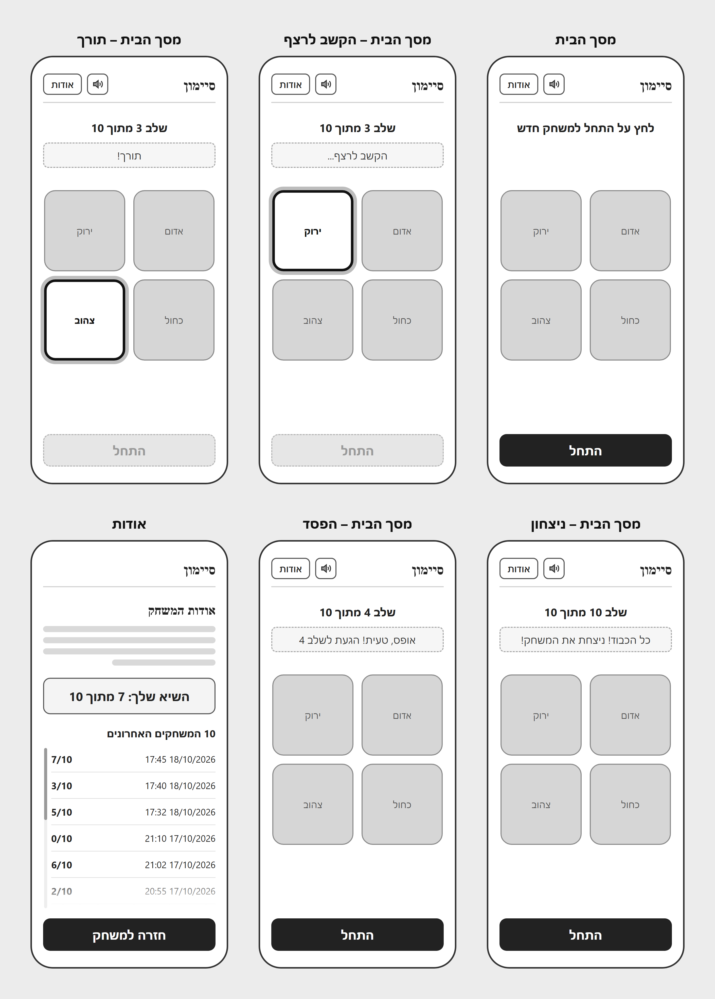
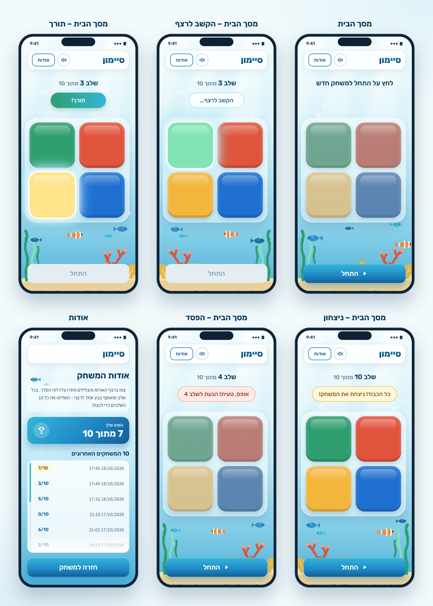
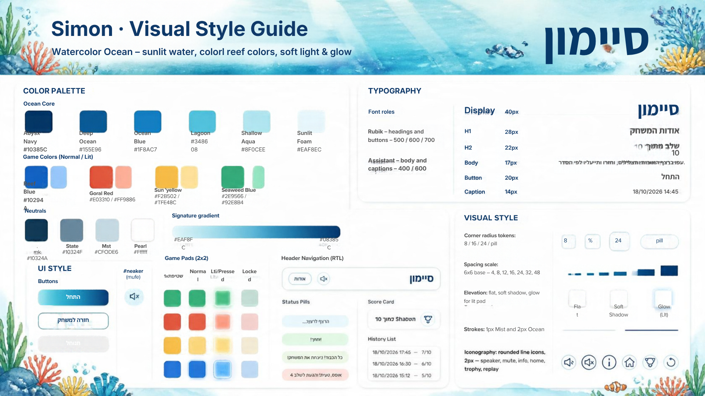

# מסמך עיצוב (DESIGN.md) – משחק הזיכרון "סיימון"

מסמך זה מתאר את המימוש העיצובי של האפליקציה. דרישות המוצר, התנהגות המשחק ועקרונות ה-UX מתועדים במסמך ה-PRD ואינם חוזרים כאן.

**מקורות:** PRD (דרישות והתנהגות), `wireframes.png` (מבנה ופריסה), `style-guide.png` (שפה עיצובית), `mockups.png` (מראה סופי).

> **הערה חשובה:** תמונת ה-Style Guide נוצרה ב-Canva ומכילה טעויות בחלק מקודי ה-HEX ובחלק מהטקסטים. **הערכים המחייבים הם אלה המופיעים בטבלאות במסמך זה**, והם גם הערכים שבהם נעשה שימוש ב-Mockups.

---

## 1. Screens – מסכי האפליקציה





האפליקציה כוללת **שני מסכים**: מסך הבית (מסך המשחק) ומסך אודות. מסך הבית מוצג ב-Wireframes וב-Mockups בחמישה מצבים (States) לפי שלבי המשחק. כל המצבים חולקים את אותו מבנה; משתנים רק טקסט השלב, הודעת הסטטוס, מצב הכפתורים הצבעוניים ומצב כפתור "התחל".

**Viewport עיצובי:** מסך Smartphone במצב Portrait, ביחס 9:19.5 (מסגרת ייחוס של 390×845px). ריווח צדדי של 20px בתוך המסך.

### 1.1 מסך הבית (מסך המשחק)

**מטרת המסך:** לשחק במשחק – לצפות ברצף, לחזור עליו וללמוד על התוצאה.

**מבנה ותוכן (מלמעלה למטה):**

| # | אזור | רכיבים |
|---|---|---|
| 1 | **Header** | מימין: כותרת `סיימון`. משמאל: כפתור אייקון השתקה (רמקול) וכפתור `אודות`. |
| 2 | **אזור מידע** | שורת שלב ממורכזת (`שלב X מתוך 10`), ומתחתיה הודעת סטטוס בצורת Pill. |
| 3 | **לוח המשחק** | 4 כפתורי צבע ברשת 2×2 בתוך מיכל (Container) שקוף-למחצה, ממורכז. |
| 4 | **אזור קרקעית** | איור תת-ימי דקורטיבי (שונית, אצות, דגים) – ללא משמעות פונקציונלית. |
| 5 | **כפתור ראשי** | כפתור `התחל` ברוחב מלא, צמוד לתחתית המסך. |

**סידור הצבעים בלוח (כפי שמוצג ב-Mockups):** ירוק – למעלה משמאל, אדום – למעלה מימין, צהוב – למטה משמאל, כחול – למטה מימין.

**מצבי המסך:**

| מצב (כותרת ב-Wireframes) | שורת שלב | הודעת סטטוס | כפתורי צבע | כפתור `התחל` |
|---|---|---|---|---|
| `מסך הבית` (התחלתי) | `לחץ על התחל למשחק חדש` | ללא (המקום נשמר ריק) | דהויים (Locked) | פעיל (Primary) |
| `מסך הבית – הקשב לרצף` | `שלב 3 מתוך 10` | `הקשב לרצף...` | בצבע מלא; הצבע המושמע במצב Lit | מושבת (Disabled) |
| `מסך הבית – תורך` | `שלב 3 מתוך 10` | `תורך!` | בצבע מלא; הצבע הנלחץ במצב Lit | מושבת (Disabled) |
| `מסך הבית – ניצחון` | `שלב 10 מתוך 10` | `כל הכבוד! ניצחת את המשחק!` | בצבע מלא | פעיל (Primary) |
| `מסך הבית – הפסד` | `שלב 4 מתוך 10` | `אופס, טעית! הגעת לשלב 4` | דהויים (Locked) | פעיל (Primary) |

(מספרי השלבים בטבלה הם ערכים לדוגמה מה-Mockups.)

**פעולות וניווט:**
- לחיצה על `התחל` – מתחילה משחק חדש.
- לחיצה על כפתור צבע – בתור השחקן בלבד.
- לחיצה על אייקון הרמקול – השתקה / הפעלת קול.
- לחיצה על `אודות` – מעבר למסך אודות.

### 1.2 מסך אודות

**מטרת המסך:** להציג הסבר קצר על המשחק, את השיא האישי ואת היסטוריית המשחקים האחרונים.

**מבנה ותוכן (מלמעלה למטה):**

| # | אזור | רכיבים |
|---|---|---|
| 1 | **Header** | כותרת `סיימון` בלבד (ללא כפתורי השתקה ואודות). |
| 2 | **כותרת מסך** | `אודות המשחק` – מיושרת לימין. |
| 3 | **פסקת הסבר** | טקסט קצר על חוקי המשחק, על גבי משטח לבן שקוף-למחצה. |
| 4 | **כרטיס שיא** | תווית `השיא שלך` וערך `X מתוך 10`, עם אייקון גביע בצד שמאל. |
| 5 | **כותרת רשימה** | `10 המשחקים האחרונים`. |
| 6 | **רשימת היסטוריה** | שורה לכל משחק: מימין תאריך ושעה (`DD/MM/YYYY HH:MM`), משמאל ציון בתג (`X/10`). מסודרת מהחדש לישן. |
| 7 | **כפתור ראשי** | `חזרה למשחק` ברוחב מלא, צמוד לתחתית. |

- הרשימה נגללת בתוך האזור שלה. רמז הגלילה: Scrollbar דק בצד שמאל ו-Fade לבן בתחתית הרשימה.
- בכרטיס השיא וברשימה ב-Mockups, התג של המשחק שהשיג את התוצאה הגבוהה מוצג בגוון צהוב (ראו Status Colors).
- במצב ריק (ללא משחקים) יוצג במקום הרשימה הטקסט `טרם שוחקו משחקים`, כמוגדר ב-PRD. מצב זה אינו מעוצב ב-Mockups – יש להשתמש באותו משטח של הרשימה עם טקסט ממורכז בצבע Slate.

**פעולות וניווט:**
- לחיצה על `חזרה למשחק` – חזרה למסך הבית.

### 1.3 מבנה הניווט הכללי

```text
מסך הבית  ──[אודות]──►  מסך אודות
    ▲                        │
    └──────[חזרה למשחק]──────┘
```

- אין תפריט ניווט נוסף. הניווט מתבצע רק באמצעות כפתור `אודות` ב-Header של מסך הבית וכפתור `חזרה למשחק` בתחתית מסך אודות.
- המעבר בין המסכים הוא החלפת תצוגה באותו עמוד. ההתנהגות בעת מעבר באמצע משחק מוגדרת ב-PRD.

---

## 2. Style Guide – השפה העיצובית



**אווירה כללית:** "Watercolor Ocean" – עולם תת-ימי בסגנון צבעי מים: מים מוארים מלמעלה, עומק כחול כלפי מטה, וצבעי שונית (אדום-אלמוג, צהוב, ירוק, כחול) כנקודות צבע. רך, אוורירי, זוהר וידידותי.

### 2.1 Color Palette

**Ocean Core – מותג ומשטחים**

| שם | HEX | שימוש |
|---|---|---|
| Abyss Navy | `#0B3B5C` | כותרות, טקסט כהה, קצה כהה של Gradients |
| Deep Ocean | `#135E96` | טקסט בכפתורים משניים, אייקונים, קצה תחתון של Primary |
| Ocean Blue | `#1F8AC7` | מסגרת כפתורים משניים, צבע ראשי של Primary |
| Lagoon | `#34B6D8` | קצה עליון של Primary, Scrollbar, הדגשות |
| Shallow Aqua | `#8FDCEE` | מסגרות עדינות, Glow |
| Sunlit Foam | `#EAF8FC` | רקע תגי ציון, משטחים בהירים |

**Game Colors – כפתורי המשחק**

| צבע | Normal | Lit / Pressed |
|---|---|---|
| Reef Blue (כחול) | `#1F6FD1` | `#7DBBFF` |
| Coral Red (אדום) | `#E0533D` | `#FF9E86` |
| Sun Yellow (צהוב) | `#F2B63D` | `#FFE48C` |
| Seaweed Green (ירוק) | `#2E9E6E` | `#82E3B4` |

**Neutrals – טקסט וקווים**

| שם | HEX | שימוש |
|---|---|---|
| Ink | `#10324A` | טקסט גוף |
| Slate | `#5B7A8F` | טקסט משני, תאריכים, תוויות |
| Mist | `#C9DDE6` | קווי מתאר ומפרידים |
| Pearl | `#FFFFFF` | משטחים וכרטיסים |

**Status Colors – הודעות סטטוס (מתוך ה-Mockups)**

| סטטוס | רקע | טקסט | מסגרת |
|---|---|---|---|
| `הקשב לרצף...` | לבן 85% | `#135E96` | `#8FDCEE` |
| `תורך!` | Gradient `#2E9E6E` → `#34B6D8` | `#FFFFFF` | ללא |
| `כל הכבוד! ניצחת את המשחק!` | `#FFF6DC` | `#8A5A00` | `#F2B63D` |
| `אופס, טעית! הגעת לשלב X` | `#FDEBE7` | `#A3301E` | `#F2A493` |

**רקע המסך:** Gradient אנכי מבהיר לכהה – `#F2FBFE` → `#DDF4FA` → `#B9E7F4` → `#7FCBE6` → `#4FAFD6`.
**Disabled:** רקע `#E4EEF2`, טקסט `#8FA9B8`, מסגרת `#D3E3EA`.

### 2.2 Typography

| גופן | שימוש | משקלים |
|---|---|---|
| **Rubik** | כותרות, כפתורים, שלב, Pills, ציונים | 500 / 600 / 700 / 800 |
| **Assistant** | טקסט גוף, תאריכים, תוויות | 400 / 600 |

שני הגופנים תומכים בעברית וזמינים ב-Google Fonts.

| רמה | גופן ומשקל | גודל / גובה שורה | דוגמה |
|---|---|---|---|
| Display | Rubik 700 | 40 / 48px | `סיימון` |
| H1 – כותרת מסך | Rubik 700 | 28 / 36px | `אודות המשחק` |
| H2 – כותרת משנה | Rubik 600 | 22 / 30px | `שלב 3 מתוך 10` |
| Body | Assistant 400 | 16–17 / 26px | פסקת ההסבר |
| Button | Rubik 600 | 20–22px | `התחל` |
| Caption | Assistant 600 | 14 / 20px | `18/10/2026 17:45` |

**שימוש בפועל ב-Mockups:**
- כותרת ה-Header `סיימון`: Rubik 800, 28px, עם Gradient בטקסט מ-`#1F8AC7` ל-`#0B3B5C`.
- שורת השלב: `שלב X` ב-Rubik 600 בצבע Abyss Navy, והמילים `מתוך 10` במשקל 500 בצבע Slate.
- כותרת הרשימה `10 המשחקים האחרונים`: Rubik 600, 19px.

### 2.3 UI Style

**כפתורים**

| סוג | מראה | שימוש |
|---|---|---|
| **Primary** | Gradient אנכי `#34B6D8` → `#1F8AC7` → `#135E96`, טקסט לבן Rubik 600 22px, גובה 62px, רדיוס 18px, צל כחול רך. ב-Mockups מוצג אייקון ▶ לצד הטקסט `התחל`. | `התחל`, `חזרה למשחק` |
| **Secondary** | רקע לבן, מסגרת 2px Ocean Blue, טקסט Deep Ocean Rubik 600 16px, גובה 42px, רדיוס 14px. | `אודות` |
| **Disabled** | צבעי Disabled (ראו 2.1), ללא צל. | `התחל` בזמן משחק פעיל |
| **Icon Button** | עיגול 42px, רקע לבן, מסגרת 2px Mist, אייקון Deep Ocean. | השתקה / הפעלת קול |

**כפתורי המשחק (Game Pads)**
- ריבוע מעוגל 148×148px, רדיוס 30px, מרווח 14px ביניהם.
- מראה תלת-ממדי עדין: צל פנימי כהה בתחתית, הבהקה (Highlight) לבנה בחלק העליון, וצל חיצוני רך.
- **Lit / Pressed:** צבע ה-Lit של אותו צבע, טבעת לבנה של 4px ו-Glow לבן ותכלת (`#8FDCEE`) סביב הכפתור.
- **Locked:** רוויה מופחתת ושקיפות קלה (כפי שמוצג במצב ההתחלתי ובמצב הפסד).
- **מיכל הלוח:** משטח לבן שקוף-למחצה (45%) עם טשטוש רקע, רדיוס 36px, ריפוד 14px, מסגרת לבנה וצל רך.

**Header**
- משטח לבן שקוף-למחצה (78%), גובה 64px, רדיוס 20px, מסגרת Mist וצל רך. הכותרת מימין והכפתורים משמאל.

**הודעות סטטוס (Pills)**
- גובה 50px, רדיוס מלא (Pill), Rubik 500 19px, ממורכזות מתחת לשורת השלב. צבעים לפי טבלת Status Colors.

**כרטיס שיא**
- Gradient אלכסוני `#34B6D8` → `#1F8AC7` → `#135E96`, טקסט לבן, רדיוס 22px, צל כחול.
- תווית `השיא שלך` (15px, 600), ערך `X מתוך 10` (Rubik 700, 30px), ואייקון גביע בעיגול לבן שקוף (20%).

**רשימת היסטוריה**
- משטח לבן (85%), רדיוס 18px, מסגרת עדינה.
- שורות בגובה 50px עם קו מפריד דק. תאריך בצבע Slate (Assistant 600, 16px). ציון בתג Pill ברקע Sunlit Foam ובטקסט Deep Ocean (Rubik 600, 15px).

**אייקונים**
- אייקוני קו מעוגלים (Rounded Line), עובי קו 2px, קצוות מעוגלים, בצבע Deep Ocean.
- אייקונים מוגדרים: רמקול, רמקול מושתק, מידע, בית, גביע, הפעלה מחדש. במסכים בפועל משמשים: רמקול (השתקה), גביע (כרטיס שיא) ו-▶ (כפתור `התחל`).

**שדות קלט ותפריטים:** אין במוצר.

### 2.4 Visual Style

**פינות (Corner Radius)**

| ערך | שימוש |
|---|---|
| 8px | תגים קטנים (Chips) |
| 14–18px | כפתורים |
| 20–24px | Header, כרטיסים, רשימות |
| 30–36px | כפתורי משחק ומיכל הלוח |
| Pill | Pills, תגי ציון, כפתור אייקון |

**ריווח (Spacing):** סקאלה על בסיס 4px – `4 · 8 · 12 · 16 · 24 · 32 · 48`. ריווח צדדי של 20px במסך, ו-14px בין כפתורי המשחק.

**קווי מתאר (Strokes):** 1px Mist למפרידים ולמשטחים; 2px Ocean Blue לכפתורים משניים; 2px Mist לכפתור אייקון.

**צללים ו-Elevation:**
- **Flat:** רשימות – מסגרת בלבד.
- **Soft:** כרטיסים, Header ומיכל הלוח – צל כחלחל רך ומפוזר.
- **Glow:** כפתור משחק במצב Lit – הילה לבנה ותכלת.

**פריסה (Layout):** עמודה אחת, רכיבים ממורכזים לרוחב. ה-Header בראש המסך, והכפתור הראשי צמוד לתחתית. אין גלילה במסך הבית; במסך אודות רק הרשימה נגללת.

**איורים ורקע (Imagery):**
- **רקע:** Gradient של מים (ראו 2.1) עם קרני אור אלכסוניות מלמעלה והשתקפויות אור עדינות.
- **קרקעית (תחתית מסך הבית):** חול, אצות ירוקות, אלמוג אדום מסתעף, אלמוג מניפה צהוב, אלמוגים כחולים וורודים וצדף. הצד מתהפך בין המסכים לגיוון.
- **דמויות:** דגים קטנים בגוני כחול, דג ליצן כתום-לבן (`#F28C3D`) וכוכב ים צהוב. מיקומם משתנה בין המסכים.
- **בועות:** עיגולים שקופים עם מסגרת לבנה והבהקה.
- **סגנון:** צבעי מים רכים ללא קווים חדים. צבעי השונית משמשים כהדגשה על רקע כחול רגוע. האיורים דקורטיביים בלבד, ממוקמים מאחורי רכיבי הממשק ואינם מסתירים טקסט או כפתורים. במסך אודות משתמשים רק בדגים קטנים ובבועות.

### 2.5 שפה וכיווניות

- **שפת ממשק:** עברית בלבד.
- **כיווניות:** RTL (`dir="rtl"`, `lang="he"`).
- **יישור:** כותרות, פסקאות ותוויות מיושרים לימין. שורת השלב, הודעות הסטטוס ולוח המשחק ממורכזים.
- **Header:** הכותרת `סיימון` בצד ימין, והכפתורים בצד שמאל.
- **שורות ההיסטוריה:** תאריך ושעה בצד ימין, וציון בצד שמאל.
- **ספרות ותאריכים:** בספרות רגילות (0–9) ובפורמט `DD/MM/YYYY HH:MM`.
